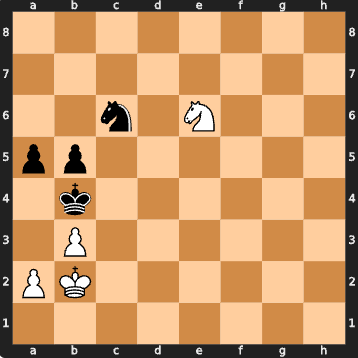

# Puzzle assistant

Dedicated coach for themed, rating-targeted **one-move** puzzles from a local Lichess-derived corpus (`puzzles.json.zst` in the project root).

## How it fits the app

Messages that mention “puzzle” (including common typos) switch from the general chess assistant into this mode. Image uploads leave puzzle mode again, because board analysis lives on the general path.

The coach uses LLM **tool calling** (Vercel AI Gateway by default):

- **`get_puzzle`** — retrieve a puzzle by rating and optional theme; the starting position is shown as a board in the UI.
- **`change_mode`** — return to the general assistant when the user is no longer talking about puzzles. Exit is blocked if the current message still contains “puzzle”, to avoid bounce-back loops.

## Example prompts

- `Give me a knight endgame puzzle rated 900.`
- `Give me a mate-in-one puzzle.`
- `Is knight to d6 the solution?`

<p align="center">
  
</p>

<p align="center"><em>Example response to a knight-endgame request around rating 900 (this position is rated 912).</em></p>

## Provider note

Puzzle mode needs `stream_tools` / session history clearing. Configure:

```dotenv
LLM_PROVIDER=gateway
LLM_MODEL=openai/gpt-5-mini
GATEWAY_API_KEY=your-api-key
```

The Gemini adapter supports streaming chat and image parsing but does not implement tool calling yet.

## Code map

| File | Role |
| --- | --- |
| `puzzle_assistant.py` | System prompt, tools, puzzle-mode I/O, keyword entry helper |
| `puzzles.py` | Load/cache corpus, rating buckets, theme filter, random retrieval |
